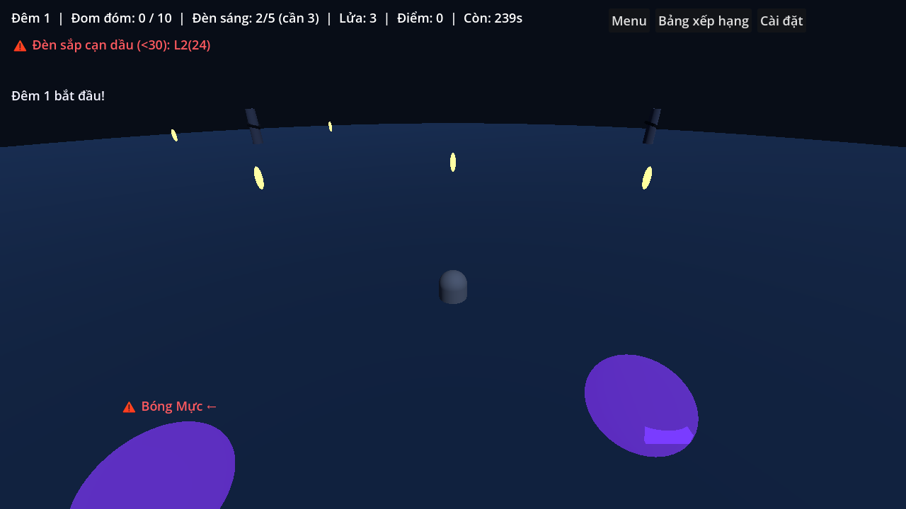

# Đảo Đèn Lồng (Lantern Island) — v1.0.0

Game 3D góc nhìn thứ ba trong **Godot 4.7.2**. Mây — người giữ đèn nhỏ tuổi — gom đom đóm để thắp sáng, thắp lại và châm dầu cho các Đèn Lồng Lớn qua 3 Đêm (Đảo Bến, Đảo Cau, Đảo Chuông), chống lại Bóng Mực hút dầu và Gió Lạc, giữ tối thiểu 60% đèn sáng để sống sót đến **Bình Minh**.

> **Release v1.0.0** · Test Contract **v1.3** · Tác giả: **Hoàng Minh Huy — 2A202603495**
> 🎬 **Video Demo Gameplay (`.mp4`, `< 5 phút`):** [Xem / Tải từ GitHub Release v1.0.0](https://github.com/hmhuyyy/K5-L3A-DAY12-HoangMinhHuy-2A202603495-AI-SDLC-Dao-Den-Long/releases/download/v1.0.0/gameplay_demo.mp4) · [File trong repo (`docs/media/gameplay_demo.mp4`)](docs/media/gameplay_demo.mp4)
> 📦 **Bản phát hành & Thực thi Windows (`v1.0.0`):** [GitHub Release v1.0.0 (`DaoDenLong-v1.0.0-win64.zip`)](https://github.com/hmhuyyy/K5-L3A-DAY12-HoangMinhHuy-2A202603495-AI-SDLC-Dao-Den-Long/releases/tag/v1.0.0)



---

## Cài đặt và Chạy ngay (Tối đa 3 lệnh)

```bash
# 1. Clone repository
git clone https://github.com/hmhuyyy/K5-L3A-DAY12-HoangMinhHuy-2A202603495-AI-SDLC-Dao-Den-Long.git
cd K5-L3A-DAY12-HoangMinhHuy-2A202603495-AI-SDLC-Dao-Den-Long

# 2. Khởi tạo class cache cho clone mới & chạy game 3D (1280x720)
godot --headless --path . --import && godot --path .
```

---

## Yêu cầu hệ thống (System Requirements)

- **Engine:** Godot Engine **4.7.2 Stable** (renderer `gl_compatibility`, không cần bước build phức tạp khi chạy từ source).
- **Hệ điều hành:** Windows 10/11 (64-bit), Linux (x86_64) hoặc macOS.
- **Phần cứng tối thiểu:** CPU 2 nhân, RAM 2 GB, GPU tích hợp hỗ trợ OpenGL 3.3 / Direct3D 12 (đã đo đạt `163.9 avg_fps` và `62.2 p1_low_fps` trên Intel Iris Xe Graphics ở `1280×720`).
- **Chạy test suite:** Bash (Git Bash trên Windows), Python 3.8+ (cho `tests/perf_bench.py`).

---

## Điều khiển (Có thể đổi phím trong Menu Cài đặt)

| Phím mặc định | Hành động |
|---|---|
| `W / A / S / D` hoặc Phím mũi tên | Di chuyển Mây |
| Chuột | Xoay góc nhìn camera |
| `Space` | Nhảy (`vel_y = 7.0`, `gravity = -20.0`) |
| `Shift` | Lướt / Dash (`14 m/s` trong `0.2s`, hồi chiêu `1.5s`, miễn hồi chiêu khi có Bùa Gió) |
| `E` | Tương tác đèn lồng gần nhất (Thắp mới 10 đom đóm / Thắp lại 5 đom đóm / Châm dầu) |
| `Q` | Tỏa Sáng / Pulse (Tốn 3 đom đóm, bán kính 3D `5m`, làm choáng Bóng Mực `120 tick`) |
| `Esc` | Tạm dừng (`Pause`) / Mở Menu |

> Mọi phím điều khiển đều có thể **Remap** trong mục **Cài đặt & Trợ năng**, có phát hiện trùng phím, thông báo rõ ràng, lưu bền vững vào `user://settings.json` và nút **Khôi phục mặc định**.

---

## Luật chơi & Cách tính điểm (Contract v1.2 / v1.3)

- **Mô hình nhiên liệu đèn:** Đèn thắp sáng có `fuel = 100`, tự hao `1.0 fuel/s` (`1/60` mỗi tick). Đèn có `fuel >= 30` tạo vùng an toàn bán kính `6m` chặn Bóng Mực. Khi `fuel < 30`, đèn mất vùng an toàn, nhấp nháy `1 Hz`, và thu hút Bóng Mực ở trạng thái `wander` vào hút dầu (`drain`, `5 fuel/s` mỗi con, cộng dồn).
- **Sức chứa tăng dần:** `capacity = min(20, 10 + 2 * successful_lights)` (tăng sau mỗi lần thắp mới hoặc thắp lại thành công).
- **Điều kiện thắng (`dawn_survived`):** Sống sót đến hết giờ (Đêm 1: `240s`, Đêm 2: `270s`, Đêm 3: `300s`) với số đèn đang sáng đạt ngưỡng `ceil(0.6 * tổng_đèn)` (Đêm 1: `3/5`, Đêm 2: `4/6`, Đêm 3: `5/7`).

| Sự kiện | Điểm |
|---|---:|
| Mỗi đom đóm nạp vào đèn (thắp mới, thắp lại, châm dầu) | `+5` |
| Thắp sáng đèn lần đầu (10 đom đóm) | `+100` |
| Thắp lại đèn đã từng sáng (5 đom đóm) | `+40` |
| Tỏa Sáng (Pulse) trúng Bóng Mực bình thường | `+5 / con` |
| Tỏa Sáng (Pulse) trúng Bóng Mực đang hút dầu (`drain`) | `+15 / con` |
| Thắng Bình Minh: mỗi đèn đang sáng | `+50 + floor(fuel)` |
| Thắng Bình Minh: mỗi Ngọn Lửa còn lại | `+50` |

---

## Các lệnh Kiểm thử, Headless, Benchmark, Soak & Leaderboard

### 1. Chạy toàn bộ Test Suite (Phase 1–4 Regression + Unit Tests)
```bash
bash tests/run_tests.sh
```

### 2. Chạy Headless Simulation (Test Contract v1.3)
```bash
godot --headless --path . --script res://src/headless.gd -- \
  --seed 42 --night 1 --ticks 14400 --out out/result.jsonl \
  [--scenario tests/scenarios/f4.json] [--inputs tests/scenarios/f4_inputs.json] [--snapshot-every 10]
```

### 3. Chạy Benchmark 3D Tiêu chuẩn (`bench_cmd` — 200 Shade, 100 Mote, 1280×720)
```bash
godot --path . --script res://src/bench.gd -- --seed 42 --duration 30 --out bench.json
```
*(Lưu ý về VSync: `bench.gd` tự động gọi `DisplayServer.window_set_vsync_mode(DisplayServer.VSYNC_DISABLED)` và ghi trường `"vsync_off": true` vào `bench.json`.)*

### 4. Chạy Soak Test 10 Đêm liên tiếp cùng Process (`soak_cmd`)
```bash
godot --headless --path . --script res://src/soak.gd -- --seed 7 --nights 10 --out soak.json
```

### 5. Xuất Bảng xếp hạng Local ra JSON (`--export-leaderboard`)
```bash
godot --headless --path . -- --export-leaderboard out/leaderboard.json
```

---

## Trợ năng (Accessibility) & Sáng tạo của tôi

- **Bảng màu dễ phân biệt (Colorblind Mode):** Đổi viền và mắt Bóng Mực từ `#7A3CFF` sang `#00B3FF`, đổi màu cảnh báo từ `#FF5A5F` sang `#FFFFFF` đi kèm biểu tượng `⚠`. Đèn tắt luôn xẹp 20% chiều cao và có mảng giấy rách tối màu; đèn đang sáng luôn có thanh nhiên liệu 3D phía trên; đèn `fuel < 30` nhấp nháy `1 Hz` để không phụ thuộc duy nhất vào màu sắc.
- **Chỉ báo hình ảnh & Mũi tên rìa màn hình:** Cảnh báo chữ kèm biểu tượng `⚠` khi Bóng Mực xuất hiện, mũi tên chỉ hướng Bóng Mực ở mép màn hình khi khuất tầm nhìn camera, cảnh báo gió sắp thổi (Đêm 3), đếm ngược 10 giây cuối và cảnh báo đèn sắp cạn dầu.
- **Giảm chuyển động (Reduce Motion) & Chữ lớn (×1.25):** Tắt rung camera và chớp màn hình khi bị thương/tỏa sáng; phóng chữ UI từ tối thiểu `18 px` lên `23 px` (`×1.25`) ở `1280×720` mà không vỡ bố cục.
- *(Mọi hiệu ứng trình diễn 3D và UI đều tách biệt hoàn toàn với `GameSim`, không làm thay đổi đầu ra headless JSONL).*

---

## Tài liệu dự án

- Đặc tả: [PRD-0.md](docs/spec/PRD-0.md) · [TICKET-02.md](docs/spec/TICKET-02.md) · [TICKET-03.md](docs/spec/TICKET-03.md) · [TICKET-04.md](docs/spec/TICKET-04.md)
- Kiến trúc & ADR: [AGENTS.md](AGENTS.md) · [assumptions.md](docs/notes/assumptions.md) · [ADR-003](docs/adr/ADR-003-lantern-fuel-and-dawn-survival.md) · [ADR-004](docs/adr/ADR-004-bench-soak-leaderboard.md) · [test-migration.md](docs/notes/test-migration.md)
- Bằng chứng & Nghiệm thu: [Phase 1](docs/proof/phase-1/EVIDENCE.md) · [Phase 2](docs/proof/phase-2/EVIDENCE.md) · [Phase 3](docs/proof/phase-3/EVIDENCE.md) · [Phase 4](docs/proof/phase-4/EVIDENCE.md) · [PROJECT_STATUS.md](docs/PROJECT_STATUS.md)
- Phát hành: [CHANGELOG.md](CHANGELOG.md) · [CREDITS.md](CREDITS.md) · [LICENSE](LICENSE) · [RETRO.md](docs/retro/RETRO.md) · [DEMO_CHECKLIST.md](docs/demo/DEMO_CHECKLIST.md)
